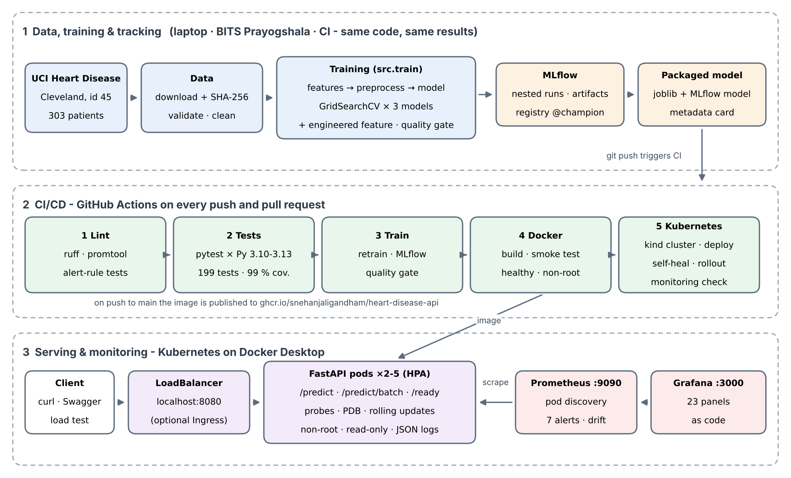

<div align="center">

# 🫀 Heart Disease Risk Prediction — End-to-End MLOps

**From raw UCI data to a tested, containerised, autoscaled and monitored prediction service**

[](https://github.com/SnehanjaliGandham/heart-disease-prediction-mlops/actions/workflows/ci.yml)


BITS Pilani WILP · M.Tech AI & ML · **MLOps (AIMLZG523) — Assignment 1**
Snehanjali Gandham · 2025AE05303

**[📄 Report](report/MLOps_Assignment1_Report_2025AE05303.pdf)** ·
**[🎬 Demo video](https://drive.google.com/file/d/1LBT4Bhkk0Xh9PKlxUtrgJyhp2BtB-PTL/view?usp=sharing)** ·
**[🐳 Container image](https://github.com/SnehanjaliGandham/heart-disease-prediction-mlops/pkgs/container/heart-disease-api)** ·
**[⚙️ CI runs](https://github.com/SnehanjaliGandham/heart-disease-prediction-mlops/actions)** ·
**[🖼️ Evidence](screenshots/README.md)**

</div>

---

## At a glance

| | |
|---|---|
| 🎯 **Model** | Logistic Regression — **CV ROC-AUC 0.911 ± 0.018**, test ROC-AUC **0.961**, recall **0.929** (26 / 28 disease cases found) |
| 🔁 **Reproducible** | identical scores to 4 decimals on a Windows laptop, GitHub CI and the **BITS Prayogshala** lab |
| ✅ **Tested** | **199** tests · **99 %** coverage · Python 3.10–3.13 · a failing change is blocked by CI |
| 🚀 **Delivered** | 5-job GitHub Actions pipeline: lint → test → train + quality gate → Docker → Kubernetes |
| ☸️ **Resilient** | 22,880 requests, **0 errors** while autoscaling 2 → 5 pods · 4,002 requests, **0 errors** during a rolling update · self-healing · rollback |
| 📈 **Observed** | Prometheus + Grafana, 7 alert rules, **data-drift detection** (age drift +1.67 σ caught within 5 min) |

<p align="center"></p>

---

## Contents

1. [Quick start](#quick-start)
2. [API access (local testing)](#api-access-local-testing)
3. [Assignment tasks → where to find them](#assignment-tasks--where-to-find-them)
4. [Results](#results)
5. [How it works](#how-it-works) — data · models · MLflow · packaging · CI/CD · API · Kubernetes · monitoring
6. [Reproducibility & BITS Prayogshala](#reproducibility--bits-prayogshala)
7. [Project structure](#project-structure)
8. [Demo video](#demo-video)

---

## Quick start

> Works on **Python 3.9 – 3.13** on Linux (incl. BITS Prayogshala), Windows and macOS. Create a fresh virtual environment on each machine.

```bash
git clone https://github.com/SnehanjaliGandham/heart-disease-prediction-mlops.git
cd heart-disease-prediction-mlops
python -m venv .venv && source .venv/bin/activate        # Windows: .venv\Scripts\activate
pip install -r requirements.txt

bash scripts/run_pipeline.sh                              # Windows: .\scripts\run_pipeline.ps1
```

That single command runs **environment check → data download & checksum → cleaning → training + MLflow → quality gate → sample prediction → lint + 199 tests**, and stops at the first failure (`--quick` / `-Quick` uses small grids).

| Then… | Command |
|---|---|
| Browse experiments | `mlflow ui --backend-store-uri sqlite:///mlflow.db` → http://127.0.0.1:5000 |
| Serve the API (Docker) | `docker build -t heart-disease-api:1.0.0 .` · `docker run -d -p 8000:8000 heart-disease-api:1.0.0` → http://localhost:8000/docs |
| API + Prometheus + Grafana | `docker compose up -d --build` → API :8000 · Prometheus :9091 · Grafana :3001 |
| Deploy to Kubernetes | `kubectl apply -k deployment/metrics-server` · `kubectl apply -k deployment/k8s` → http://localhost:8080 |
| Monitoring on Kubernetes | `kubectl apply -k deployment/monitoring` → Prometheus :9090 · Grafana :3000 |
| Verify any deployment | `python scripts/smoke_test.py --url http://localhost:8080` (8 checks) |

---

## API access (local testing)

> The assignment allows a public cloud **or** local Kubernetes. The API is deployed on **local Kubernetes (Docker Desktop)**, so there is no public URL — these are the access instructions for local testing.

**Option A — Kubernetes (as deployed and evaluated in the report, Section 9):**

```bash
docker build -t heart-disease-api:1.0.0 .                     # image used by the cluster
kubectl apply -k deployment/metrics-server                     # needed by the autoscaler
kubectl apply -k deployment/k8s                                # deployment, LoadBalancer service, HPA, PDB, ConfigMap
kubectl -n heart-disease rollout status deployment/heart-disease-api
python scripts/smoke_test.py --url http://localhost:8080       # 8 end-to-end checks
```

**Option B — Docker only (no Kubernetes needed):**

```bash
docker build -t heart-disease-api:1.0.0 .
docker run -d -p 8000:8000 --name heart-api heart-disease-api:1.0.0
python scripts/smoke_test.py --url http://localhost:8000
```

**Send a prediction** (use port 8080 for Kubernetes, 8000 for Docker):

```bash
curl -X POST http://localhost:8080/predict -H "Content-Type: application/json" -d @samples/high_risk.json
# PowerShell:
# Invoke-RestMethod http://localhost:8080/predict -Method Post -ContentType application/json -InFile samples/high_risk.json
```

| URL | What it is |
|---|---|
| http://localhost:8080/docs | Swagger UI — try `/predict` interactively |
| http://localhost:8080/model-info | which model is served, its parameters and test metrics |
| http://localhost:8080/health · /ready | liveness · readiness |
| http://localhost:8080/metrics | Prometheus metrics |
| http://localhost:3000 · http://localhost:9090 | Grafana · Prometheus, after `kubectl apply -k deployment/monitoring` |

Example response: `{"prediction": 1, "label": "Heart disease", "probability_disease": 0.9787, "confidence": 0.9787, "model_version": "logistic_regression-c19ff10", "request_id": "..."}`

---

## Assignment tasks → where to find them

| # | Task | Implementation | Evidence |
|---|---|---|---|
| 1 | Data acquisition & EDA | [`scripts/download_data.py`](scripts/download_data.py), [`src/data.py`](src/data.py), [`notebooks/01_data_acquisition_eda.ipynb`](notebooks/01_data_acquisition_eda.ipynb) | `task1_*` |
| 2 | Feature engineering & models | [`src/features.py`](src/features.py), [`src/models.py`](src/models.py), [`src/train.py`](src/train.py), [`notebooks/02_model_development.ipynb`](notebooks/02_model_development.ipynb) | `task2_*` |
| 3 | Experiment tracking | MLflow logging and registry in [`src/train.py`](src/train.py) | `task3_*` |
| 4 | Packaging & reproducibility | [`models/`](models), [`requirements.txt`](requirements.txt), [`requirements-lock.txt`](requirements-lock.txt), [`scripts/quality_gate.py`](scripts/quality_gate.py), [`scripts/run_pipeline.sh`](scripts/run_pipeline.sh) | `task4_*` |
| 5 | CI/CD & automated testing | [`tests/`](tests), [`.github/workflows/ci.yml`](.github/workflows/ci.yml) | `task5_*` |
| 6 | Model containerisation | [`Dockerfile`](Dockerfile), [`src/api/`](src/api), [`notebooks/03_inference.ipynb`](notebooks/03_inference.ipynb) | `task6_*` |
| 7 | Production deployment | [`deployment/k8s/`](deployment/k8s), [`deployment/k8s-optional/`](deployment/k8s-optional), [`scripts/load_test.py`](scripts/load_test.py) | `task7_*` |
| 8 | Monitoring & logging | [`src/api/observability.py`](src/api/observability.py), [`deployment/monitoring/`](deployment/monitoring), [`docker-compose.yml`](docker-compose.yml) | `task8_*` |
| 9 | Documentation | this README, the [10-page report](report/MLOps_Assignment1_Report_2025AE05303.pdf), the [demo video](#demo-video) | `task9_*` |

All 80 screenshots are indexed by task in [`screenshots/README.md`](screenshots/README.md); `python scripts/check_evidence.py` confirms none is missing.

---

## Results

| Model | CV ROC-AUC (5-fold) | Over-fit gap | Test accuracy | Test precision | Test recall | Test ROC-AUC |
|---|---|---|---|---|---|---|
| **Logistic Regression ✔** | **0.911 ± 0.018** | **0.015** | 0.885 | 0.839 | 0.929 | **0.961** |
| Random Forest | 0.900 ± 0.032 | 0.057 | 0.885 | 0.839 | 0.929 | 0.955 |
| Gradient Boosting | 0.884 ± 0.027 | 0.077 | 0.902 | 0.867 | 0.929 | 0.960 |
| Majority baseline | 0.500 | 0.000 | 0.541 | 0.000 | 0.000 | 0.500 |

**Why Logistic Regression?** It wins on every criterion fixed *before* training: the highest and most stable cross-validated ROC-AUC and an over-fitting gap 4–5× smaller than the tree ensembles — and it is the easiest model to explain and the cheapest to serve. Gradient Boosting's higher test accuracy is a single patient out of 61, and the test set is reserved for the final report, never for choosing.

---

## How it works

<details open>
<summary><b>1 · Data — verified, validated, leak-free</b></summary>

* **Source:** UCI Heart Disease, Cleveland subset (id 45, CC BY 4.0) — 303 patients, 13 inputs, diagnosis binarised to *disease = num > 0*. The 1,025-row Kaggle copy was rejected because most of its rows are duplicates.
* **Download** via the official `ucimlrepo` client; shape asserted; **SHA-256 recorded in a manifest** and re-checked on every run (line-ending-safe, so Windows and Linux agree).
* **Validation:** schema, valid UCI codes, clinical ranges (shared with the API), duplicates. Result: 6 missing values (`ca` 4, `thal` 2), 164 healthy / 139 diseased.
* Missing values are imputed **inside the model pipeline**, learned on training folds only — no leakage.
</details>

<details>
<summary><b>2 · Features & model selection</b></summary>

* One scikit-learn `Pipeline`: median imputation + scaling (numeric), most-frequent imputation + one-hot (coded) → 25 features.
* **Engineered feature** `hr_pct_predicted = thalach / (220 − age)` — share of the age-predicted maximum heart rate. It is a **switch in every grid**, so the data decides: informative alone (0.85 vs 0.95), but redundant next to `age` and `thalach`, so the search left it out ([`reports/feature_ablation.csv`](reports/feature_ablation.csv)).
* `GridSearchCV`, stratified 5-fold CV, 5 metrics, 153 settings / 765 fits across LR, RF and GB plus a majority baseline.
* **Selection rule written before training** ([`src/config.py`](src/config.py)): models within 0.01 ROC-AUC of the best are tied; the simplest wins. Over-fitting measured as train-fold minus validation-fold ROC-AUC.
</details>

<details>
<summary><b>3 · Experiment tracking — MLflow</b></summary>

* Experiment `heart-disease-classification`: one **parent run** per training call (git commit, versions, data hash, selection rule, dataset input, comparison and ROC artifacts) and one **child run per model** (parameters, CV mean ± std, test metrics, plots, the pipeline as an MLflow model with signature).
* Winner registered as **`heart-disease-classifier`** with alias **`@champion`**. A unit test checks MLflow's numbers equal the code's.
</details>

<details>
<summary><b>4 · Packaging & reproducibility</b></summary>

* `models/heart_disease_model.joblib` — the complete pipeline (callers send 13 raw values) · `models/mlflow_model/` — same pipeline in MLflow format · `models/model_metadata.json` — model card (served at `/model-info`).
* Reload check after saving · scikit-learn version check at load time · **quality gate** (CV & test ROC-AUC ≥ 0.85, recall ≥ 0.80, accuracy ≥ 0.75, ≥ 0.2 above baseline).
* `requirements.txt` (ranges) + `requirements-lock.txt` (exact), fixed seeds, one-command pipeline.
</details>

<details>
<summary><b>5 · CI/CD & testing</b></summary>

| Job | What it does | Fails when |
|---|---|---|
| 1 · Static checks | `ruff`; `promtool` validates Prometheus config and unit-tests the alert rules | lint finding, invalid config, alert misbehaves |
| 2 · Tests | pytest on Python 3.10, 3.11, 3.12, 3.13 with coverage, JUnit/HTML reports | a test fails or coverage < 90 % |
| 3 · Model | verify data hash → clean → train + MLflow → quality gate → inference → model tests → execute notebooks | any error or a failed gate |
| 4 · Docker | build with job 3's model → run → smoke test → healthy → non-root → push to GHCR | build, smoke or health failure |
| 5 · Kubernetes | kind cluster → deploy → smoke test → delete a pod → rolling update → deploy monitoring → verify scraping | pods not ready or any check fails |

Tests cover data, features (leakage guard), training, MLflow, the API (10 invalid-input cases, logs without patient data), the Kubernetes manifests and the monitoring config (every metric a dashboard or alert uses must exist). A deliberately failing pull request proves the pipeline blocks bad changes.
</details>

<details>
<summary><b>6 · Prediction API & container</b></summary>

| Endpoint | Purpose |
|---|---|
| `POST /predict` | one patient → `prediction`, `label`, `probability_disease`, `confidence`, `model_version`, `request_id` |
| `POST /predict/batch` | up to 100 patients |
| `GET /health` · `GET /ready` | liveness · readiness (503 until the model is loaded) |
| `GET /model-info` · `GET /metrics` · `GET /docs` | model card · Prometheus metrics · Swagger UI |

```bash
curl -X POST http://localhost:8000/predict -H "Content-Type: application/json" -d @samples/high_risk.json
# PowerShell: Invoke-RestMethod http://localhost:8000/predict -Method Post -ContentType application/json -InFile samples/high_risk.json
```

Clinical-range and UCI-code validation (HTTP 422 per field, never a stack trace) · JSON logs with request IDs and **no patient data** · two-stage image with serving packages only (154 MB) · non-root user 10001 · read-only code and model · `HEALTHCHECK` on `/ready` · published to GHCR by CI.
</details>

<details>
<summary><b>7 · Kubernetes deployment</b></summary>

| Object | Purpose |
|---|---|
| Deployment | 2 replicas, rolling updates that never reduce capacity, 5 s `preStop`, startup/readiness/liveness probes, resource requests and limits, locked-down security context |
| Service (LoadBalancer) | `http://localhost:8080` on Docker Desktop, a public IP on a cloud cluster |
| HorizontalPodAutoscaler | 2–5 pods at 60 % CPU (metrics-server in `deployment/metrics-server`) |
| PodDisruptionBudget · ConfigMap | at least one pod always up · threshold and log level without rebuilding |

| Demonstrated | Result |
|---|---|
| Load: 16 clients × 3 min | CPU 5 % → 791 %, **2 → 5 → 2 pods**, 22,880 requests, **0 errors**, p95 300 ms |
| Rolling update under load | 4,002 requests, **0 errors** |
| Delete a pod | replaced in seconds, no failed requests |
| Broken release → `kubectl rollout undo` | old pods kept serving; previous version restored |

```bash
python scripts/load_test.py --url http://localhost:8080 --duration 180 --workers 16
kubectl -n heart-disease get hpa -w
kubectl -n heart-disease rollout restart deployment/heart-disease-api
kubectl -n heart-disease rollout undo deployment/heart-disease-api
```
</details>

<details>
<summary><b>8 · Monitoring, alerting & drift</b></summary>

* **Metrics** on every pod: traffic, latency, predictions per class, probability histogram, rejections, per-feature inputs, model version, CPU/memory, and each feature's **training mean and std** (read from the served model's scaler).
* **Prometheus** discovers pods through the Kubernetes API, so autoscaled replicas are scraped automatically. **Grafana** is provisioned from files — no manual setup.
* **Drift score** = (15-min input mean − training mean) / training std. Real traffic stays within ±0.07; `load_test.py --profile drifted` pushes age to **+1.67 σ** and fires `HeartApiInputDrift`.

| Alert | Fires when | Severity |
|---|---|---|
| HeartApiDown · HeartApiNoTargets | a pod cannot be scraped · no pods found | critical |
| HeartApiHighErrorRate | > 5 % 5xx for 5 min | critical |
| HeartApiSlowPredictions | p95 `/predict` > 500 ms for 10 min | warning |
| HeartApiInputDrift | \|drift\| > 0.5 for 5 min (≥ 50 requests) | warning |
| HeartApiPredictionShift | positive share < 20 % or > 80 % | warning |
| HeartApiManyInvalidRequests | > 20 % of requests rejected | warning |

Grafana: dashboards are viewable without login; `admin` / `admin` to edit (development set-up — a Kubernetes Secret in production).
</details>

---

## Reproducibility & BITS Prayogshala

The full model pipeline was re-run from a fresh clone on the **BITS Prayogshala** virtual lab (Linux, Python 3.12.9): download and checksum, EDA notebook, training with MLflow, model registry, quality gate, 199 tests and the one-command pipeline.

| Run | LR CV ROC-AUC | RF CV ROC-AUC | GB CV ROC-AUC | LR test ROC-AUC |
|---|---|---|---|---|
| Laptop — Windows 11, Python 3.13 | 0.9113 | 0.8998 | 0.8839 | 0.961 |
| GitHub Actions — ubuntu-24.04, Python 3.12 | 0.9113 | 0.8998 | 0.8839 | 0.961 |
| **BITS Prayogshala — Linux, Python 3.12.9** | **0.9113** | **0.8998** | **0.8839** | **0.961** |

```bash
python3 scripts/check_env.py      # checks Python, packages, network, docker, kubectl on a new machine
```

---

## Project structure

```text
├── src/                        Python package
│   ├── config.py               paths, features, ranges, selection rule — single source of truth
│   ├── data.py                 load · validate · clean · split
│   ├── features.py             engineered feature + preprocessing
│   ├── models.py               candidate models and hyper-parameter grids
│   ├── train.py                tuning, selection, MLflow logging, packaging
│   ├── evaluate.py             metrics and plots
│   ├── predict.py              score patients with the packaged model
│   └── api/                    FastAPI app · schemas · JSON logging · Prometheus metrics
├── notebooks/                  01 EDA · 02 model development · 03 inference (all executed)
├── scripts/                    download · pipeline · quality gate · smoke/load tests · checks
├── tests/                      199 pytest tests
├── data/                       raw + clean CSV, variable descriptions, SHA-256 manifest
├── models/                     packaged model (joblib + MLflow format) and model card
├── reports/                    comparison table, feature ablation, figures
├── deployment/
│   ├── k8s/                    Deployment · Service · HPA · PDB · ConfigMap (Kustomize)
│   ├── k8s-optional/           Ingress variant
│   ├── metrics-server/         metrics-server for the autoscaler
│   └── monitoring/             Prometheus (config, alerts, rule tests) · Grafana (dashboard)
├── .github/workflows/ci.yml    5-job CI/CD pipeline
├── Dockerfile · docker-compose.yml · requirements*.txt
├── report/                     final 10-page report (PDF + DOCX)
└── screenshots/                80 evidence screenshots, indexed by task
```

---

## Demo video

🎬 **[Watch the end-to-end demo](https://drive.google.com/file/d/1LBT4Bhkk0Xh9PKlxUtrgJyhp2BtB-PTL/view?usp=sharing)** — report and repository tour, the pipeline running live on BITS Prayogshala, MLflow tracking and registry, CI/CD, the prediction API, and the Kubernetes and drift-monitoring results.

---

<sub>Dataset: Janosi, Steinbrunn, Pfisterer & Detrano (1989), *Heart Disease*, UCI Machine Learning Repository, doi:10.24432/C52P4X (CC BY 4.0). Coursework project — not a medical device.</sub>
